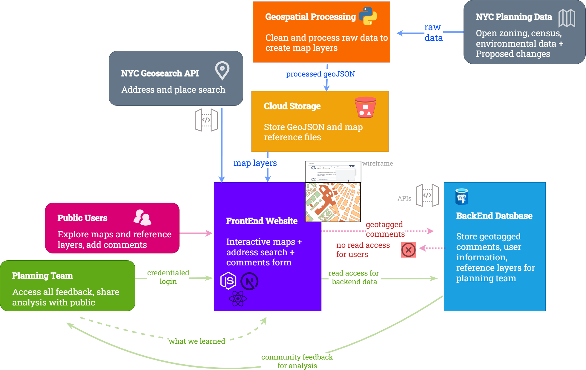

# Samriddhi Khare for WXY Urban Analyst 

Thank you for the opportunity to work on these questions. I really enjoyed it!

## A. Web Development

### 1. Code Base

[Link to Codebase](https://github.com/samriddhikhar3/samriddhikhar3.github.io)

This is my urban analytics portfolio that I created independently.

 I have also worked on the [North Philadelphia Black Freedom Jawn](https://storymaps.arcgis.com/stories/65d2396a7d2f4ae393bf5eb394d43e08) website, where I did the asset mapping, brochure design (for four out of the eight themes) and independently managed the data analysis and web development for all virtual tours.

### 2. NYC Planning Website

For this project, I would draw heavily on my experience working on the [Main Bhi Dilli](https://www.mainbhidilli.com/) campaign in 2021, which solicited community feedback on the New Delhi 2041 Master Plan. I constantly prioritized accessibility while developing and sharing planning materials with community members. The maps I designed used recognizable community landmarks, transportation hubs and local language names (in place of technical geographics like census tracts or zipcodes) to contextualize the proposals. Building on this experience, and my web development work for the University of Pennsylvania, I would develop a mobile-friendly __website with a React and Next.js interface, supported by Python-based spatial data processing and a PostgreSQL/PostGIS database,__ for the NYC DCP that allowed residents to explore proposed changes and submit location-specific feedback to the planning team.

_Image 1: Digital access and literacy was a significant consideration during the Main Bhi Dilli campaign, so participants placed colored stickers or "bindis" on maps to identify where they wanted transit stops, housing, and public amenities such as bathrooms, and public spaces._

As illustrated in Figure 1 below, I would start by using Python to clean and process planning and zoning data and map proposed changes. I would export the processed layers as GeoJSON for display in an interactive Leaflet map on React on the front end. I would also integrate the NYC GeoSearch API to my front end to help residents locate places on the map. This would offer a better alternative to using property data as the API can account for variations in spellings and familiar place names. While submitting feedback, residents will be asked to pin their submissions to a location (or select a “City-wide” option) , categorise their submissions into themes like housing and transit and optionally provide contact information, which will all be stored in a PostgreSQL/PostGIS database. I would implement role-based access controls so residents could submit feedback without viewing other participants' comments, while authorized members of the planning team could review submissions.

_Figure 1: Website Architecture_

Finally, I would prioritize transparency throughout the planning process. The planning team could analyse public comments and present key takeaways on the website under a “What We’ve Learned” section. This would prevent over-reporting of a previously recorded comment while helping policymakers understand which issues are emerging across the neighborhood. A public calendar of upcoming planning meetings and other key milestones would further connect community feedback to the broader planning process.

## C. Use of LLMs

I have integrated LLMs (Codex, Claude, Co-pilot) across my workflow to speed up research and development and automate and streamline tasks. It also helps me with project documentation and cleaning up my code. I prioritize checking its accuracy and do not use LLMs for writing or while I am working with sensitive data. While developing a scenario modelling tool for NJ Transit's Secaucus Meadowlands Transitway project, I significantly sped up my work by automating repetitive data pulls and geospatial operations (buffering, joining, intersecting) for every station or bus stop along the proposed redevelopment. I have also led knowledge sharing sessions as a data analyst at EConsult Solutions where I taught my peers best practices in prompt engineering and creating custom GPTs.

